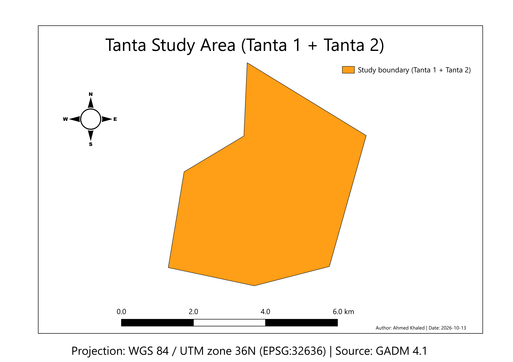

# Tanta Access Intelligence

A spatial analysis project that asks: **how easy is it, in practice, for people in Tanta to reach urban services through the road network?**

The goal is not to draw points and lines on a map. The goal is a spatial solution whose results can be **explained and tested**, and later a reproducible Python workflow.

## Status

| # | Stage | Status |
|---|---|---|
| 1 | Business problem | Initial definition |
| 2 | Engineering thinking | In progress |
| 3 | GIS model and study area | Done: city boundary built from two administrative districts |
| 4 | Data quality and CRS | Done: boundary validated and reprojected to a metric CRS |
| 5 | Roads and services data | **Next** |
| 6 | Spatial logic (distances, access) | Not started |
| 7 | Python automation | Not started |
| 8 | Testing and portfolio | Not started |

A stage is marked done only when its output exists and was checked. Evidence for stages 3 and 4 is in [`docs/geo-log/`](docs/geo-log/).



## What has been done so far

Starting from GADM 4.1 administrative boundaries for Egypt:

1. Located Tanta in the level-2 layer (343 features). Tanta appears as **three** records in Al Gharbiyah: `Tanta` (a *Markaz*, the large surrounding district) and `Tanta 1` and `Tanta 2` (two *Kism*, the city's own subdivisions).
2. Chose the **city only**: `Tanta 1` + `Tanta 2`.
3. Merged them into one polygon (`Dissolve`).
4. Checked the geometry with `Check validity` (GEOS): **1 valid, 0 invalid, 0 errors**.
5. Reprojected a copy to **EPSG:32636 (WGS 84 / UTM zone 36N)** so distances and areas can later be measured in metres. The original stays in EPSG:4326.

| Output | CRS | Features | Purpose |
|---|---|---|---|
| `tanta_1_2_admin_parts.gpkg` | EPSG:4326 | 2 | the two districts kept separate, original attributes (traceability) |
| `tanta_study_boundary.gpkg` | EPSG:4326 | 1 | unified study boundary |
| `tanta_study_boundary_utm36n.gpkg` | EPSG:32636 | 1 | copy for metric measurements |

## Repository layout

```
tanta-access-intelligence/
├── README.md
├── CHANGELOG.md
├── docs/
│   ├── 01-project-overview.md
│   ├── 02-roadmap.md
│   ├── geo-log/          one file per completed task (GEO-001..003)
│   ├── decisions/        short records of key choices and rejected options
│   ├── evidence/         screenshots that back the results in the log
│   ├── expected-results.md   values to compare your own run against
│   └── lessons-learned.md
├── data/                 data notes only; files are downloaded, not committed
├── qgis/                 QGIS layout template and layer style
├── src/                  Python code (after the analysis is proven in QGIS)
└── tests/
```

## Data and license

Boundaries come from [GADM](https://gadm.org) version 4.1. GADM data is free for academic and non-commercial use and **may not be redistributed without permission**, so this repository does not contain the data files. See [`data/README.md`](data/README.md) for how to download them and recreate the outputs.

## Known limitations

- GADM boundaries are generalised (few vertices, straight edges). They are suitable as a study boundary, not as survey-grade limits.
- In `tanta_study_boundary*.gpkg` the attribute table holds the values of the **first merged record** (`Tanta 1`), although the shape covers both districts. The traceable attributes live in `tanta_1_2_admin_parts.gpkg`.
- No area or distance has been computed yet.

## Tools

QGIS 4.0.3 (GDAL 3.13.0, GEOS 3.14.1, PROJ 9.8.1). Python (GeoPandas) comes in stage 7.

## License

Code and documentation: MIT (see the repository root). Data: see above.
