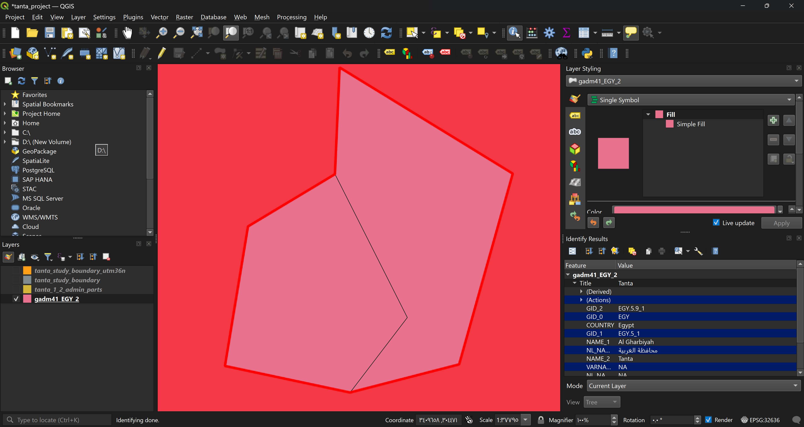
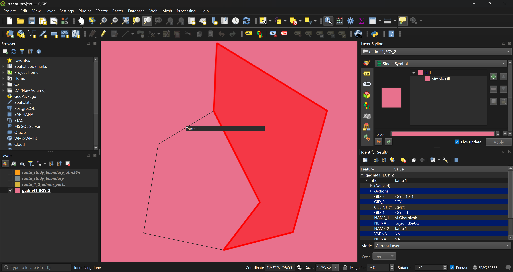
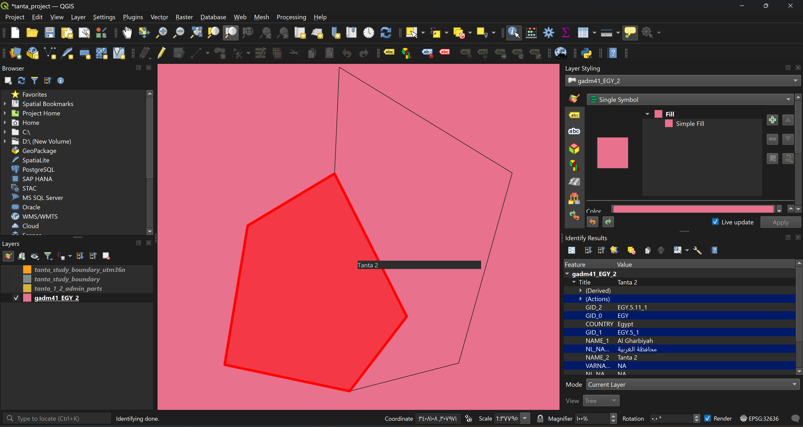
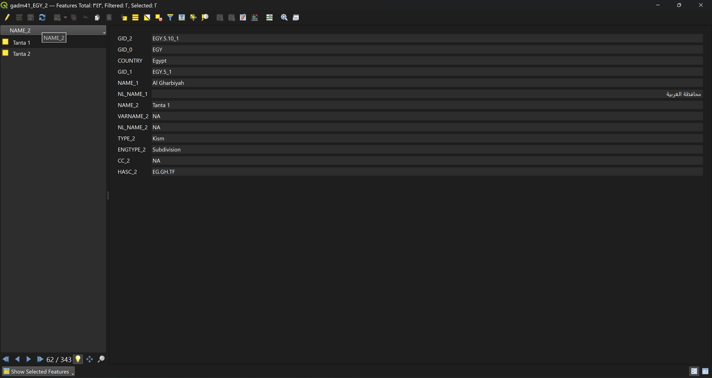

# GEO-001: Study area

**Goal:** get a single, traceable boundary for the city of Tanta from GADM 4.1.

## Why this step exists

Every later measurement (service counts, distances, coverage) is relative to a boundary. If the boundary is wrong, every result is wrong, and nobody can tell from the numbers alone. So the study area is defined first, on purpose, and its origin is kept traceable.

## Steps and the reason for each

| Step | Action | Why |
|---|---|---|
| 1 | Opened `gadm41_EGY_1` (27 features) | It only has governorates (`NAME_1`). Tanta is not here, because it is below governorate level. |
| 2 | Added `gadm41_EGY_2` (343 features) | Level 2 holds *markaz* and *kism* units, and has `NAME_2`. |
| 3 | Selected with `"NAME_1" = 'Al Gharbiyah' AND "NAME_2" LIKE 'Tanta%'` | Exploration: see everything whose name starts with Tanta. |
| 4 | Identified each shape on the map | Names alone do not say which shape is which. |
| 5 | Re-selected with `"NAME_1" = 'Al Gharbiyah' AND "NAME_2" IN ('Tanta 1', 'Tanta 2')` | Now the target is known, so match exact names only. |
| 6 | Exported the 2 selected features to `tanta_1_2_admin_parts.gpkg` | Keep the original attributes of each district for traceability. |
| 7 | Ran `Dissolve` (Vector geometry), no dissolve field, into `tanta_study_boundary.gpkg` | Remove the line between the districts to get one polygon. |

## Result of the exploration (step 3)

The query returned **3** records, all in Al Gharbiyah:

| NAME_2 | GID_2 | TYPE_2 | Role |
|---|---|---|---|
| Tanta | EGY.5.9_1 | Markaz | large surrounding district |
| Tanta 1 | EGY.5.10_1 | Kism | part of the city itself |
| Tanta 2 | EGY.5.11_1 | Kism | part of the city itself |

On the map, `Tanta 1` and `Tanta 2` form a small pocket inside `Tanta`, split by a thin line, and are adjacent with no gaps.

## Decision

Study area = **city only** (`Tanta 1` + `Tanta 2`). See [ADR-0001](../decisions/ADR-0001-study-area.md).

## Evidence

- Selection after step 5: 2 of 343 selected, names `Tanta 1` and `Tanta 2`.
- `tanta_1_2_admin_parts`: 2 features, original fields kept (`NAME_2`, `GID_2`, `TYPE_2`, and so on).
- `tanta_study_boundary`: 1 feature, no dividing line on the map.

## Caveat

`Dissolve` keeps the attribute values of the first record. In `tanta_study_boundary` the fields therefore say `Tanta 1` (`EGY.5.10_1`) although the shape covers both districts. Use `tanta_1_2_admin_parts.gpkg` for traceable attributes.

## Screenshots

