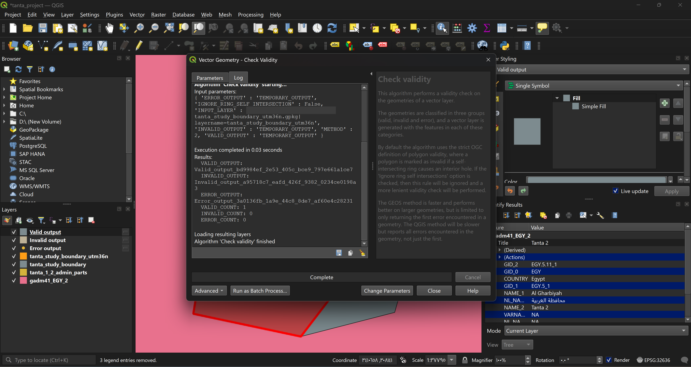

# GEO-002: Boundary quality check

**Goal:** confirm the boundary geometry is valid before it is used in any analysis.

## Why this step exists

An invalid polygon (for example one whose edge crosses itself) can make area, overlay and distance tools fail or return wrong answers without any error message. The check is cheap, so it is done before anything is built on the boundary. It only inspects; it does not change the data.

## Steps

1. Processing Toolbox, `Check validity` (Vector geometry).
2. Input layer: `tanta_study_boundary_utm36n`.
3. Method: `GEOS` (default). `Ignore ring self-intersection`: off (strict OGC definition).
4. All three outputs (valid, invalid, error): temporary layers.
5. Read the counts in the algorithm log.

## Result

| Output | Count |
|---|---|
| Valid | 1 |
| Invalid | 0 |
| Error | 0 |

Log excerpt: `VALID_COUNT: 1`, `INVALID_COUNT: 0`, `ERROR_COUNT: 0`. Run on QGIS 4.0.3 with GEOS 3.14.1.

## Decision

The geometry is valid, so **`Fix geometries` was not used**. If a feature had been invalid, the plan was to find the cause first: automatic repair can change the shape (and so areas) without anyone noticing.

## Notes

- Geometry type: Polygon (MultiPolygon), one feature. A MultiPolygon type with a single record is normal after a dissolve.
- The check was run on the EPSG:32636 copy only.

## Screenshot

