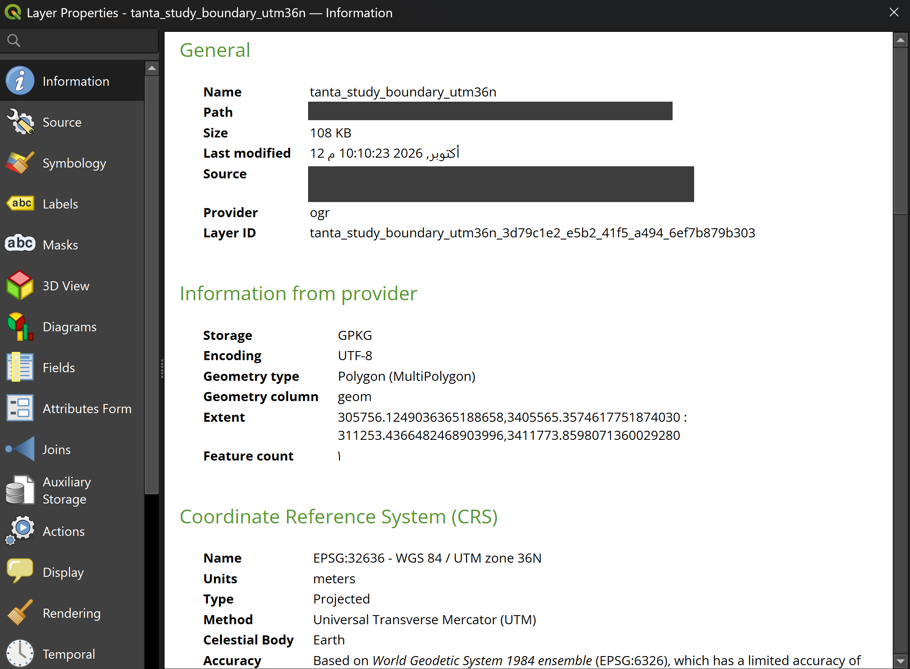

# GEO-003: Reprojection for measurement

**Goal:** produce a copy of the boundary in a coordinate system where lengths and areas are in metres.

## Why this step exists

The GADM data is in EPSG:4326 (longitude and latitude, in degrees). A distance or an area computed in degrees has no direct meaning in metres, and one degree of longitude is not the same length as one degree of latitude at Tanta's latitude. Measurements need a projected CRS.

## Choice of CRS

EPSG:32636 (WGS 84 / UTM zone 36N). Reasons: the source data already uses WGS 84, so no datum transformation is needed; the zone covers longitudes 30 to 36 degrees east, and Tanta is at about 31 degrees east; units are metres. See [ADR-0003](../decisions/ADR-0003-crs.md).

## Steps

1. Right-click `tanta_study_boundary`, `Export`, `Save Features As...`.
2. Format GeoPackage, file `tanta_study_boundary_utm36n`, CRS `EPSG:32636`, all fields kept.
3. Check in `Properties`, `Information`.

**Not** done: `Set Layer CRS`. That only relabels the layer without converting any coordinate, and would put the shape in the wrong place.

## Result

| Property | Value |
|---|---|
| CRS | EPSG:32636, WGS 84 / UTM zone 36N |
| Units | metres |
| Geometry type | Polygon (MultiPolygon) |
| Feature count | 1 |
| Extent | X 305756 to 311253, Y 3405565 to 3411773 |

The extent is in the hundreds of thousands (X) and millions (Y) of metres, not in the 30s: the coordinates were converted. The bounding box is roughly 5.5 km by 6.2 km, which matches the size of the original extent in degrees. The shape looks identical to the original.

## Decision

- Study boundary in EPSG:4326 stays as the reference copy.
- All metric work uses `tanta_study_boundary_utm36n.gpkg`.
- No area or distance has been computed yet.

## Screenshot

